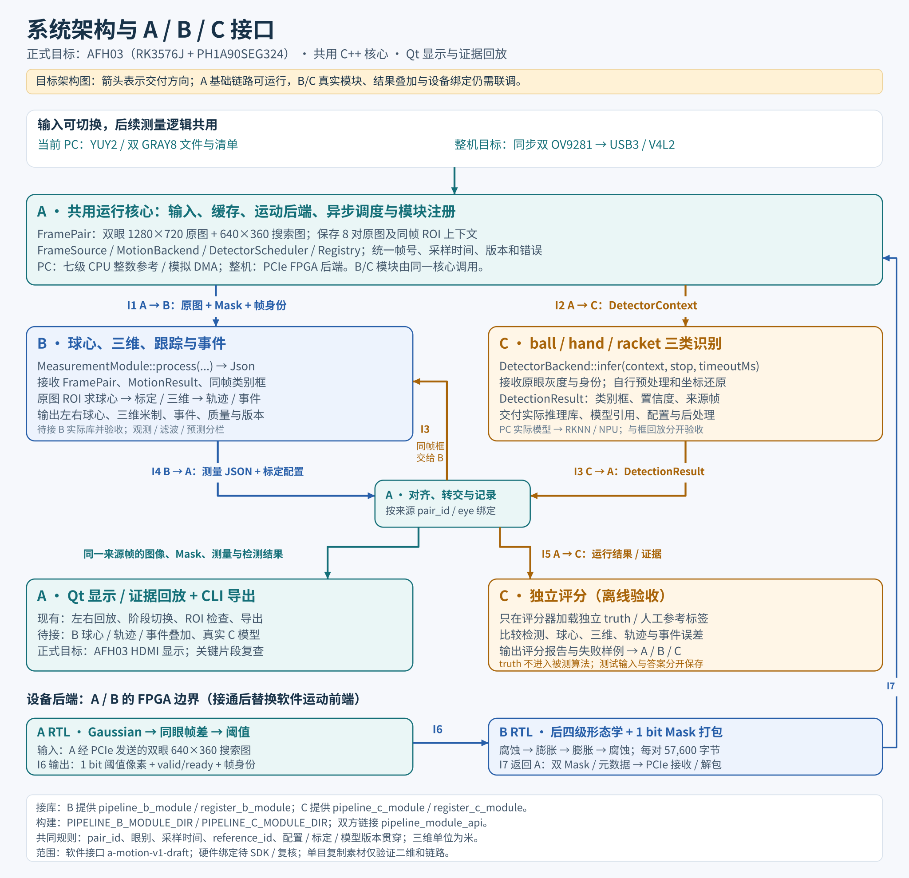

# 系统架构、Qt 定位与 A/B/C 接口

2026-10-08；依据当前总路线、三人分工与 A 现行软件接口。本文解释现有接口及目标接入关系，没有修改图像、模型、坐标、阈值或通信协议。箭头表示目标交付方向，不表示所有连接已经验收。

[SVG 矢量图](ABC系统架构与接口_20261008.svg)可放大和打印；[Mermaid 源码](ABC系统架构与接口_20261008.mmd)可编辑结构。

## Qt 回放应用的定位

Qt 是项目长期保留的显示、回放与证据复查层。共用 C++ 核心承担输入、运动处理、B 测量、C 推理及调度；Qt 负责把核心的结果显示出来，CLI 提供无界面的运行与导出入口。最终技术路线第 3 节还计划在 AFH03 上通过 HDMI 显示左右画面、球心、类别框、轨迹、事件、帧率和模式。板端 Qt/OpenGL ES 与实时输入仍需适配及实测。

当前 A 便携版已经能读取文件、同步回放左右眼、查看七级处理与 Mask、检查同帧 ROI，并导出图像和记录。当前 `ViewWorker` 读取 `FileFrameSource` 并运行 CPU 运动参考；预览尚未调用 B 的测量模块。B/C 可选库的运行接入口位于共用核心，实际模块、球心/轨迹/事件叠加及实时板端显示需继续联调。

| 阶段 | Qt 要承担的功能 | 当前范围 |
| --- | --- | --- |
| 当前文件输入阶段 | 查看左右原图、运动结果、ROI、来源帧；导出异常材料 | A 基础链路已实现；文件模式 |
| B/C 接通后的 PC 系统 | 显示自动球心、模型类别框、三维轨迹、关键事件及质量；逐帧复查并保存证据 | 接口已预留，实际模块及完整叠加待联调 |
| 最终 AFH03 系统 | 实时测量结果与运行状态显示；关键片段保存及离线重放；CPU/FPGA 对照 | 总路线目标，依赖设备、显示环境和实际验证 |

人工球心标签编辑不是现有点击 ROI 功能；若增加标注功能，应单独实现标签保存与独立评分，禁止把评分答案传入被测算法。Qt 文件回放阶段会长期保留，供真实采集后的故障重现、参数/版本回归和证据复核。

## 三个角色交付与接收

| 角色 | 必须提供给队友 | 从队友接收 |
| --- | --- | --- |
| A | 共用核心与 API、输入/缓存、FramePair、MotionResult、整数黄金图、前三级 RTL；B/C 调用、来源对齐、Qt/CLI 和部署适配 | B 的测量库/结果与标定配置、后四级与 Mask 打包；C 的推理库/模型引用/预处理配置/独立测试包和评分报告 |
| B | `pipeline_b_module`、MeasurementModule 实现、球心/三维/轨迹/事件结果、质量/版本与标定配置；后四级 RTL/打包、TB 与日志；独立场景描述供 C 评分 | A 的原图/Mask/时间/帧号/参考身份/ROI 规则/API/整数参考/前三级流；C 的三类框、模型版本与独立评分反馈 |
| C | `pipeline_c_module`、DetectorBackend 实现、PT/ONNX/RKNN 本地引用与哈希、预处理及后处理、DetectionResult；有许可的数据/标签、分组清单、独立评分器与报告 | A 的检测上下文/调度 API/来源约定/运行证据；B 的球心/三维/事件结果、标定与世界系说明、独立合成场景描述 |

模型权重、原始媒体和厂商 SDK 通过本地或有权限的存储引用，图中接口不表示这些文件需上传到 Git。

## 图中接口的实际落地

| 编号 / 方向 | 数据或材料 | 当前调用入口 / 约束 |
| --- | --- | --- |
| I1 A → B 软件 | FramePair：双眼原图/搜索图；MotionResult：两眼 Mask、参考身份、错误；同帧有效检测框 | `MeasurementModule::process(const FramePair&, const MotionResult&, const std::vector<DetectionResult>&)`；最终球心回原眼坐标 |
| I2 A → C 软件 | DetectorContext：复制的原眼 GRAY8、Meta、eye、origin、尺寸、task/generation、参考身份 | `DetectorBackend::infer(context, stop, timeoutMs)`；C 自行做 gray3/letterbox/归一化与坐标逆变换 |
| I3 C → A → B 软件 | DetectionResult：ball/hand/racket、confidence、原眼 bbox `[x,y,width,height]`、Meta、状态与来源 | C 返回给 A 的完成队列；同帧且有效时进 B 的 `process()`；迟到结果经 `acceptDetections()` 接收并归档；不是 C 直接调用 B |
| I4 B → A 软件 / 配置 | 测量 Json：同帧球心、米制三维、滤波/预测、事件、质量与版本；B 的标定/世界变换配置 | `process()` 返回 Json；`version()` 标识模块；标定配置由 B 保存/加载并向 A 提供版本及部署材料。测量 JSON 字段仍须联合评审，不在此新增二进制布局 |
| I5 A/B ↔ C 离线验收 | A 运行结果/图像/日志；B 测量与场景说明；C 测试输入、独立 truth、评分报告与失败样例 | 输入供核心处理；truth 只给独立评分器。独立真值不能来自被测程序自己的输出 |
| I6 A RTL → B RTL | 每像素 1 bit threshold；valid/ready、x/y/last、eye、pair/time/config/reference | `motion_front3` 输出；B 后四级必须传递同一身份，并技术复核启动边沿、短帧、复位/提交语义 |
| I7 B RTL → A 接收 | 双眼最终 640×360 Mask，各 28,800 字节，共 57,600 字节/对；元数据及完成/错误 | B 打包，A 经 PCIe/DMA 接收解包为 MotionResult。bit0 对应像素0是软件草案；实际 SDK/DDR3L/IP 与硬件协议仍待取得、复核和蒲公英审批 |

C 的模型类别框帮助 B 确定球身份、重新寻找球以及分析手/拍关系；B 的主路径仍可从 Mask 与轨迹找到候选并精测。三维、离手、最高点和触拍由 B 的测量/事件模块处理。评分报告反馈给三人，具体结果仍按实际数据集和运行日志验收。

## CMake 与模块注册

B 提供 `pipeline_b_module`，实现 `pipeline::register_b_module(Registry&)` 并设置 `registry.measurement`。C 提供 `pipeline_c_module`，实现 `pipeline::register_c_module(Registry&)` 并设置 `registry.detector`。两库包含 `pipeline/pipeline.hpp` 并链接 `pipeline_module_api`；A 使用 `PIPELINE_B_MODULE_DIR` 与 `PIPELINE_C_MODULE_DIR` 接入。

测试模块、检测框 replay、实际 PC 模型、RKNN/NPU 分别标记。接口测试库返回空/invalid 测量，不能通过真实模型或 `--full` 门禁。共用核心可以无界面运行，Qt 与 CLI 应使用同一份来源正确的测量结果；界面刷新不能代替算法吞吐、准确率或上板验收。

## 架构不变而切换的后端

| 功能 | 当前软件阶段 | 最终整机目标 |
| --- | --- | --- |
| 输入 | FileFrameSource 文件 | UVC/V4L2 相机输入 |
| 运动前端 | A 的 CPU 七级整数参考 / 模拟 DMA | A 前三级 + B 后四级/打包，PCIe/DDR3L 后端 |
| 三类检测 | C 的实际 PC 模型；显式框回放另验 | C 的 RKNN/NPU 后端 |
| 球心/三维/跟踪/事件 | B 的共用 C++ 算法 | 同一核心迁移到 RK3576J |
| 显示与复查 | PC Qt / CLI / 文件记录 | AFH03 实时显示与保存；PC 长期证据回放 |

当前 125 对素材是单目左右复制，只用于二维/像素/接口/生命周期测试；8 对 A/B 人工接口图也没有米制标定。真实三维验证需要独立投影双目或真实同步双目与标定。H10 CK203 已到货，用作 PH1A180/DDR3 预验证；它与 AFH03 的 RK3576J/PH1A90SEG324/DDR3L/PCIe 整机分别验收。

## 依据与重绘

- [总路线第 3 节结果呈现](../../plans/current/usb-stereo/技术路线_AFH03与USB同步双目测量方案.md#3-结果呈现)：正式 Qt/HDMI 显示、证据保存与实机目标。
- [A 分工](../../项目规划/AFH03_USB同步双目方案一个月分工/01_A_USB采集与FPGA链路职责说明.md)、[B 分工](../../项目规划/AFH03_USB同步双目方案一个月分工/02_B_FPGA视觉与三维测量职责说明.md)、[C 分工](../../项目规划/AFH03_USB同步双目方案一个月分工/03_C_AI模型训练与部署职责说明.md)。
- [现行 API](../../software/pc_pipeline/include/pipeline/pipeline.hpp)、[软件接口草案](../../software/pc_pipeline/contracts/a-motion-v1.md)、[核心调用](../../software/pc_pipeline/src/runner.cpp)、[现有 Qt](../../software/pc_pipeline/src/gui.cpp)、[B 接入材料](../B接入A交付材料.md)。

仓库根运行 `python tools/docs/render_abc_architecture.py` 重绘 PNG/SVG；依赖 Pillow 及 Windows `C:/Windows/Fonts/msyh*.ttc`，可通过 `--font-dir` 指定字体目录。PNG为本地导出，仓库共享SVG及结构源码。B球心和形态学参考已合入，图中的MeasurementModule注册库、真实C模型与完整Qt叠加仍待接入；图不代表整机验收通过。

[本轮整理与复核记录](../../reports/仓库整理与PR复核_20261008.json)包含文件哈希、图像尺寸、输入依据与实际执行的检查范围。
