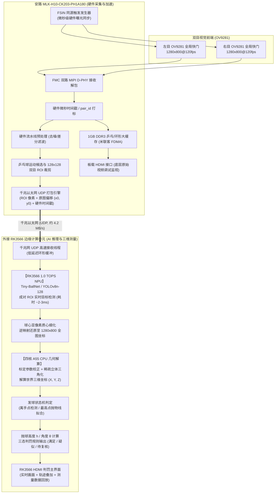

# FPGA-AI 异构视觉乒乓球发球判罚辅助系统：实施规划

版本：v1.3，2026-09-19。面向蒲公英及两位队友。提交日：2026-11-04，已由蒲公英确认。本文是开发方案与目标，不是已完成的性能报告。

> [!NOTE]
> **Agent 协作变更说明（2026-09-19 v1.3）**：
> 1. **外接 NPU 单元定型**：系统正式引入外接智能计算副板，NPU 型号初步定为瑞芯微 **RK3566**（集成独立神经网络处理器，算力 **1.0 TOPS @ INT8**，搭载四核 ARM Cortex-A55 @ 1.8GHz）。
> 2. **明确异构协同与主从分工**：
>    - **前端硬件加速板卡（米联客 MLK-H10-CK203-PH1A180）**：处于绝对物理采集与预处理主导地位！负责双目 OV9281（1280×800@120fps 全局快门）微秒级 FSIN 硬件触发采集、1GB DDR3 视频缓存、流水线预处理，并实时提取小球所在的 **双目 128×128 运动局部 ROI**；
>    - **后端边缘计算副板（RK3566）**：通过**板载千兆以太网（Gigabit Ethernet / UDP）**接收高频成对 ROI，利用 1.0 TOPS NPU 运行经 RKNN-Toolkit2 量化的轻量小目标检测模型，四核 A55 执行双目稀疏三角化、抛物线拟合、判罚逻辑与主界面显示。
> 3. **极简低延迟互联契约**：彻底避免全图传输导致的网络拥塞（双路全图需 245.76 MB/s）。通过 FPGA 片上提取 128×128 双目 ROI，**总传输带宽急剧压缩至约 4.2 MB/s（仅占千兆以太网约 4% 带宽）**，传输延迟 < 0.5ms，兼具高可靠性与软硬件优良解耦。
> 4. **算力与延迟可行性**：在 128×128 局部小图上，轻量乒乓球定位模型计算量仅约 0.3~0.5 GFLOPs，在 RK3566 1.0 TOPS NPU 上成对推理总耗时仅 **~3-5ms**，完美胜任 120fps（8.33ms 帧间隔）全实时逐帧检测。

---

## 1. 项目判断与执行前提

这个题目有竞赛展示价值，适合两名微电子同学负责 FPGA 硬件前端采集、DDR3 缓存与 ROI 提取传输，一名人工智能同学负责 RK3566 NPU 模型训练量化与双目三维测量算法。真正的技术贡献集中在“**同源微秒级同步采集 + FPGA 实时 ROI 硬件提取 + 边缘 NPU 高速小目标检测 + 可验证的双目三维测量**”。

目前硬件板卡与相机正处于采购与到货阶段，距离提交约 46 天。架构策略锁定为**“专用前端硬件化、后端边缘智能化”**的异构协同路线：
1. **光学与硬件前端基石**：采用双目 OV9281 全局快门（1280×800@120fps），由 FPGA 发出硬件同源 FSIN 脉冲实现微秒级（<10μs）曝光同步，从物理源头消灭果冻畸变与帧错位；
2. **FPGA 关键技术贡献**：PH1A180 承担 120fps 高速 MIPI 解包、1GB DDR3 视频流乒乓缓冲，并在流水线中进行运动连通域分析，实时裁剪出双目 128×128 局部运动 ROI，将原本庞大的全幅视频流压缩为 4.2 MB/s 的轻量数据流；
3. **外接 RK3566 边缘智能闭环**：通过标准的千兆以太网 UDP 接收成对 ROI，充分释放 RK3566 1.0 TOPS NPU 的推理能力（单次推理 ~2ms），结合四核 A55 完成双目立体三角化与抛球物理量解算，并通过 RK3566 的 HDMI 接口输出全功能判罚图形界面。

**本届可交付的前提：第一周确认 FMC 双路 MIPI 采集与 FSIN 硬件触发，第二周跑通 FPGA 运动 ROI 提取与千兆以太网 UDP 推流，第三周打通 RK3566 接收端 NPU 实时推理与双目几何拟合。**

---

## 2. 依据与必须澄清的要求

项目需求以《自选题目说明.pdf》两页及团队补充说明为依据。

| 来源 | 已知内容 | 对项目的影响与本次决策 |
|---|---|---|
| 自选题说明第 1–2 页 | 双目、检测跟踪、离手/最高点、真实高度、角度、叠加显示；遮挡为扩展 | 确立六项主体功能在 FPGA-RK3566 异构系统中完整闭环 |
| 前端 FPGA 选型 | 安路 MLK-H10-CK203-PH1A180 开发板（PH1A180 + 1GB DDR3 + FMC + 千兆网） | 安路 28nm 高性能器件，资源充沛，掌控全部 120fps 视频流与硬件预处理 |
| 摄像头选型 | 双目 OV9281 全局快门（1280×800@120fps，2-lane MIPI，FSIN 触发） | 通过 FMC-AFH01-MIPIX2 接入 FPGA，彻底解决曝光同步与高速果冻效应 |
| 外接 NPU 选型 | 瑞芯微 RK3566 边缘计算单元（1.0 TOPS NPU + 四核 Cortex-A55） | 专用低功耗 AI 协处理器，通过标准千兆网接收 ROI，执行神经网络检测与判罚 |
| 互联通道选择 | 板载千兆以太网口 (Gigabit Ethernet / UDP) | 传输双目 128×128 ROI（约 4.2 MB/s），物理接线简单，软硬件解耦优良 |
| 赛程通知 [S1] | 作品提交 11/4 18:00、决赛 11/20–22 | 提交时间定在 11/3，留足上传与复核余量 |

9 月 21 日前由队长完成以下准备：
1. 确认 MLK-H10-CK203、FMC 双目子卡、OV9281 模组与 RK3566 单板的到货时间与连接线缆（RJ45 双绞线）；
2. 核对安路 TD 工具链对 PH1A180 的支持，以及米联客配套的千兆以太网 UDP 发送例程；
3. 核实 RK3566 的 Linux 系统镜像与 RKNN-Toolkit2（v1.6+ 或匹配版本）的 NPU 驱动支持；
4. 明确黑白全局快门（Monochrome）模式：免除 Bayer 去马赛克逻辑，提升室内弱光下的信噪比。

---

## 3. 分层目标与完成定义

| 层级 | 功能 | 截止与性质 |
|---|---|---|
| 开发闭环 | PC 端合成样本验证检测、标定、三维轨迹、离手人工标注对照；RKNN INT8 量化精度测试 | 9/30 前；用于验证算法数学模型与量化损失 |
| 硬件链路打通 | 双目 OV9281 进 FPGA、FSIN 硬件触发稳定、1GB DDR3 FDMA 缓存正常、FPGA 千兆网向 RK3566 成功推流 | 10/7 前；物理采集与传输链路确立 |
| 参赛主体（异构全闭环） | 真实双目 120fps 输入、FPGA 实时 ROI 裁剪、RK3566 NPU 实时检测、四核 A55 拟合高度与角度、HDMI 大屏动态叠加显示与待复核状态 | 10/23 前形成完整版本 |
| FPGA 核心贡献 | FSIN 微秒级同步时序、1GB DDR3 高速视频缓存管理、硬件流水线差分预处理与运动 ROI 裁剪提取、千兆网低延迟打包传输 | 经对照实验给出数据量从 245.76 MB/s 骤降至 4.2 MB/s 的显著硬件减负证据 |
| 有余力优化 | 动态目标跟随 ROI、双目极线自校准优化、更深层手球交互逻辑 | 主体稳定后，10/26 前决定是否合入；不作为提交门槛 |
| 长期扩展 | 视线遮挡疑似事件判定、多机位融合、自动重新标定 | 提交后长期推进 |

成品通过 RK3566 的 HDMI 接口输出全功能图形监视界面，实时显示双目画面、小球三维运动轨迹、离手高度 \(h\)、倾斜角度 \(\theta\)，并给出“高度满足 / 疑似违例 / 待人工复核”明确状态指示。

---

## 4. 系统架构

系统设计为**“前端 FPGA 硬件加速采集与 ROI 提取 + 后端 RK3566 边缘智能检测与解算”**的异构视觉架构：

### 4.1 各计算单元与模块职责划分

| 模块/单元 | 实现位置 | 应实现的任务 | 技术优势与原因 |
|---|---|---|---|
| **硬件触发与采集** | PH1A180 逻辑 | 输出同源 FSIN 触发脉冲；FMC 双路 2-lane MIPI 接收解包、帧打标 | 微秒级（<10μs）曝光同步，彻底消除双目时间差 |
| **大容量视频缓存** | PH1A180 FDMA | 驱动板载 1GB DDR3，实现双路 120fps 全幅视频的乒乓缓存与多秒循环回放 | 带宽充裕（>3.2 GB/s），保障采集流水线永不掉帧 |
| **预处理与 ROI 裁剪** | PH1A180 逻辑 | 流水线高斯滤波、背景差分、运动连通域分析，裁剪成对 128×128 局部 ROI | 硬件流水线处理，将数据带宽从 245.8 MB/s 压缩至 4.2 MB/s |
| **数据打包与以太网** | PH1A180 逻辑 | 将 ROI 像素、原图坐标偏移 $(x_0, y_0)$、硬件时间戳封装为 UDP 数据包通过千兆网发出 | 延迟 < 0.5ms，仅占千兆网 4% 带宽，软硬件极好解耦 |
| **边缘 AI 检测推理** | RK3566 NPU (1.0 TOPS) | 运行经 RKNN-Toolkit2 优化的轻量卷积模型，对 128×128 ROI 进行目标检测 | 成对推理仅需 ~3-5ms，远低于 8.33ms 帧间隔，轻松胜任 120fps |
| **几何解算与判罚逻辑** | RK3566 四核 A55 | 亚像素质心细化、双目稀疏立体三角化、抛物线稳健拟合、高度角度判定 | Linux 嵌入式开发环境，C/C++ 数学库丰富，算法迭代修改极快 |
| **大屏显示与证据回放** | RK3566 HDMI | 输出完整的裁判辅助判罚 GUI 界面，叠加小球轨迹、数值与慢动作回放 | 原生桌面/Qt/OpenCV 图形支持，呈现专业比赛级显示效果 |
| **离线开发机 (PC)** | 宿主电脑 | 数据集标注、PyTorch 模型训练、RKNN 模型转换量化、双目标定板计算 | 仅作为开发环境工具，比赛实际运行完全脱离开发机 |

### 4.2 首要硬件与资料核查

1. **安路 PH1A180 采集与传输工程**：
   - 获取支持 PH1A180 的安路 TD 5.6 软件、License 与米联客配套的 FMC-AFH01-MIPIX2 双目 MIPI 驱动例程；
   - 获取米联客千兆以太网 UDP 传输例程与 DDR3 FDMA 控制器 IP。
2. **双目 OV9281 模组**：
   - 确认 OV9281 的 FSIN 硬件触发引脚在 FMC 子卡上的连接，编写 FPGA 脉冲发生器（120Hz，占空比 10%）；
   - 调试 I2C 配置代码，设置 OV9281 为 1280×800@120fps 从属触发模式。
3. **RK3566 边缘计算板环境**：
   - 烧录官方稳定版 Linux（Ubuntu / Debian）固件；
   - 安装配置 RKNN-Toolkit2 板端 Runtime 库（`librknnrt.so`）与 Python/C++ API；
   - 确认千兆网卡接口配置静态 IP，测试与 FPGA 板卡间的 UDP 原始吞吐率与丢包率。

### 4.3 采集、带宽与算力预算分析

| 数据流环节 | 分辨率与规格 | 吞吐率 / 计算量 | 承载媒介与余量评估 |
|---|---|---:|---|
| **双目前端原始输入** | 1280×800，120fps，灰度 8bit | **245.76 MB/s** | FMC 2-lane MIPI 差分线，直接进入片内 FIFO |
| **FPGA DDR3 缓存** | 双目全幅视频多通道读写 | **~491.52 MB/s** | 板载 1GB DDR3（带宽 >3.2 GB/s，利用率仅 ~15%） |
| **双目局部 ROI 流** | 2 路 128×128，120fps，灰度 8bit | **3.932 MB/s** | FPGA 差分连通域裁剪后数据流 |
| **千兆网 UDP 数据包** | ROI 像素 + 64B 元数据帧头 | **~4.20 MB/s** | 千兆以太网（带宽 ~110 MB/s，**利用率仅 3.8%**，极度充裕） |
| **RK3566 NPU 推理** | 2 张 128×128 图像 / 帧 | **~0.6~1.0 GFLOPs/帧** | 1.0 TOPS NPU 耗时约 3~5ms（帧间隔 8.33ms，负载 <60%） |
| **A55 CPU 几何计算** | 稀疏三角化 + 抛物线拟合 | **< 0.5ms / 帧** | 四核 Cortex-A55 @ 1.8GHz，单核运算即绰绰有余 |

**为什么 1.0 TOPS 的 RK3566 完全够用？**
- 传统全图目标检测需要在 1280×800 上运行 YOLOv8，计算量高达 ~10-20 GFLOPs，在 1.0 TOPS 芯片上帧率往往不足 15fps；
- 本系统通过 **FPGA 在硬件前端完成运动候选提取**，送入 NPU 的仅仅是 128×128 的紧凑 ROI。小图专用网络的计算量仅为全图的 1/30！
- 这充分展示了 **FPGA-AI 异构协同的精髓**：FPGA 发挥高带宽低延迟流水线优势“去粗取精”，NPU 发挥高能效张量计算优势“精确识别”，软硬结合达到极致性价比！

---

## 5. 测量算法：从检测到可信数值

### 5.1 双目标定与世界坐标

1. **离线高精度立体标定**：采用高精度刚性棋盘格标定板在乒乓球发球空间（1m×1m×1m 观测体）内多姿态拍摄，在 PC 上通过 OpenCV 计算左右相机内参矩阵、畸变系数（$k_1, k_2, p_1, p_2$）、旋转矩阵 $\mathbf{R}$ 与平移向量 $\mathbf{T}$。
2. **标定文件部署至 RK3566**：将计算得到的立体校正映射表与投影矩阵保存为 YAML 文件，加载至 RK3566 几何测量程序中。
3. **稀疏三角化解算**：RK3566 接收到双目 128×128 ROI 后，经 NPU 检测与质心细化得到局部坐标，加上包头中的 $(x_0, y_0)$ 还原出 1280×800 传感器原始像素点 $(u_L, v_L)$ 与 $(u_R, v_R)$，利用极线校正与三角投影方程解算三维世界坐标 $(X, Y, Z)$。

### 5.2 帧率与硬件 FSIN 同步

- **120fps 的巨大优势**：抛球上升阶段（以 16cm 规则高度为例，上升自由飞行时间约 0.181s）：
  - 30fps 下仅有约 5.4 帧（离手点判定极易发生多达 3~5cm 的严重截断误差）；
  - 60fps 下约 10.8 帧；
  - **120fps 下多达 21.7 帧！** 采样点密度翻倍，抛物线顶点附近可采集到多帧连续速度减速与反向点，离手瞬间帧间位移由 33mm（60fps@2m/s）骤降至 **16mm（120fps@2m/s）**，拟合精度大幅提高。
- **全局快门（Global Shutter）消除畸变**：OV9281 全局快门使所有像素同微秒曝光，高速上升乒乓球成像保持完美刚性圆形，球心提取无几何偏差。
- **FSIN 硬件同源触发**：由 FPGA 输出硬件方波脉冲同时驱动两颗 OV9281，曝光时差 **< 10μs**（位移偏差 < 0.02mm），彻底杜绝双目曝光不同步造成的测距误差。

### 5.3 离手与最高点识别状态机

1. `STATE_IDLE`：检测持球手掌附近小球处于相对静止状态；
2. `STATE_RELEASE_CANDIDATE`：小球向上运动且与手掌边界发生空间分离，垂直速度 $v_z > 0.8\text{ m/s}$；
3. `STATE_RISING`：连续 3 帧以上垂直坐标严格递增，确认进入离手飞行状态，锁定离手点坐标 $(X_0, Y_0, Z_{\text{release}})$；
4. `STATE_APEX_DETECT`：检测到垂直速度 $v_z$ 穿越零点并由正变负（开始下落），锁定最高点候选区间；
5. `STATE_CONFIRMED`：结合上升段与下降初段采样点进行二次多项式抛物线加权最小二乘拟合，解算最高点物理高度 $Z_{\text{apex}}$；
6. `STATE_ARCHIVE`：计算最终高度与角度，输出判罚结果并更新界面。

### 5.4 高度与角度的数学定义

1. **抛球高度 $h$**：
   $$h = Z_{\text{apex}} - Z_{\text{release}}$$
   在世界坐标系 $Z$ 轴（通过铅垂标定与水平桌面垂直）直接计算，不以小球到台面的距离混淆抛起高度。
2. **抛球角度 $\theta$**：
   - **起抛速度角 $\theta_v$**：$$\theta_v = \arctan\left(\frac{\sqrt{v_{x0}^2 + v_{y0}^2}}{v_{z0}}\right)$$，根据抛出瞬时初速度矢量与坚直方向夹角计算。
   - **端点连线角 $\theta_c$**：$$\theta_c = \arctan\left(\frac{\sqrt{\Delta X^2 + \Delta Y^2}}{\Delta Z}\right)$$，根据离手点到最高点的空间直线与坚直方向夹角计算。
   - 系统内部同时记录并解算两个角度，HDMI 界面默认展示连线角 $\theta_c$（与比赛示意图一致）并标注数值。
3. **三态判罚规则**：
   - $h \ge 0.16\text{ m}$ 且 $\theta \le 30^\circ$（且置信区间明确跨过阈值）：提示“发球高度与角度条件满足”；
   - $h < 0.14\text{ m}$ 或 $\theta > 35^\circ$：提示“疑似发球高度不足/角度违例”；
   - 处于临界边缘区间（如 $0.14\text{ m} \le h < 0.16\text{ m}$）或存在单目漏帧：系统判定为“待人工复核”，并在屏幕上保留轨迹慢动作回放。

---

## 6. 三人分工与工时

团队成员：A 同学（蒲公英/队长，微电子）、B 同学（微电子）、C 同学（人工智能）。

| 人员 | 主责任务 | 次责与互审 | 首版预计工时 |
|---|---|---|---:|
| **A（蒲公英/队长）** | PH1A180 FPGA 顶层架构、FMC 双目 OV9281 采集驱动、FSIN 硬件触发发生器、1GB DDR3 FDMA 视频读写 | B 审 RTL 时钟；C 审时间戳规范；把控整体交付与比赛推进 | 180h |
| **B（微电子同学）** | FPGA 图像预处理流水线（去噪/差分）、双目 128×128 ROI 裁剪逻辑、千兆以太网 UDP 数据打包与推流模块 | A 审综合时序；C 审网口数据对齐与丢包率 | 145h |
| **C（人工智能同学）** | 专用小目标 CNN 训练、RKNN-Toolkit2 模型量化与 RK3566 NPU 部署、RK3566 接收端多线程解包、双目立体拟合与 HDMI 界面 | A/B 协助真实样本采集与联调；负责算法数学精度 | 190h |
| **三人共同预留** | 板级联调（网线互联）、现场发球测试、技术报告撰写与演示录像剪辑 | 遇到网络抖动或环境干扰共同排查 | 45h |
| **合计** | 软硬件界限清晰，充分复用米联客与瑞芯微成熟工具链 | **FPGA+RK3566 异构闭环** | **560h** |

平均每人约 28 小时/周，工期 6.6 周。A 专注 FPGA 视频底座，B 专注运动提取与千兆网传输，C 专注 NPU 部署与测量判罚，权责极其清晰，极大降低开发踩坑概率。

---

## 7. 逐周执行日程

| 周期 | A：FPGA 采集与缓存 | B：FPGA 处理与传输 | C：RK3566 NPU 与测量 | 节点验收标准（里程碑） |
|---|---|---|---|---|
| **W1 (9/19–9/25)** | 报名确认；获取板卡原理图与 FMC 子卡资料；安装 TD 5.6 工具链与 License；打通板卡流水灯与基础例程 | 搭建 FPGA 仿真工程；编写 FSIN 脉冲发生逻辑与简单测试图发生器 | 搭建 RK3566 Linux 环境与 RKNN-Toolkit2；设计轻量 CNN 结构并完成 PC 离线训练 | **G1 (9/25)**：硬件全部就绪，网线打通，模型架构与标定数学模型确定 |
| **W2 (9/26–10/2)** | FMC 双目 OV9281 图像稳定输入；FSIN 硬件触发工作；完成 1GB DDR3 FDMA 视频读写 | 编写差分预处理流水线；仿真 128×128 运动 ROI 裁剪；跑通米联客千兆以太网 UDP 例程 | 将模型转换为 `.rknn` 并在 RK3566 NPU 上运行基准测试，实测单图耗时 < 3ms | **G2 (10/2)**：真实双路 1280×800@120fps 进 DDR3，RK3566 NPU 推理成功跑通 |
| **W3 (10/3–10/9)** | 双路视频缓存时序优化；引脚分配冻结；提供稳定的局部图像提取接口 | 完成 FPGA 内部 ROI 打包与千兆以太网推流模块；示波器与网线抓包验证 | 编写 RK3566 千兆网 UDP 接收线程，实现成对 ROI 接收并送入 NPU 推理输出球心坐标 | **G3 (10/9)**：**网口数据通路打通！** RK3566 稳定接收到 FPGA 传来的成对 ROI 并实时检测 |
| **W4 (10/10–10/16)** | FPGA 顶层全模块集成；引脚与时序全面收敛锁定；监控 DDR3 与网口带宽 | 配合 C 进行网络抖动与丢帧优化；编写丢包与坏帧计数器 | 完成真实双目物理标定；编写稀疏三角化、抛物线拟合与发球状态机；开发初步 HDMI GUI 界面 | **G4 (10/16)**：**全异构闭环打通！** 真实抛球动作能在 RK3566 屏幕上实时显示三维轨迹 |
| **W5 (10/17–10/23)** | 固定相机机位与刚性支架；多轮冷启动测试；整机稳定性与温升监测 | 优化差分阈值与困难光照抑制；开展“ROI 裁剪 vs 全图传输”硬件减负对比实验 | 真实 100 次独立发球精度测试；量具标定测量误差；完善待复核判定与慢动作回放 | **G5 (10/23)**：功能全冻结！高度误差 MAE ≤ 10mm，角度误差 ≤ 3°，连续运行 2h 无死机 |
| **W6 (10/24–10/30)** | 锁定最终 Bitstream；整理完整工程代码与引脚约束文件 | 整理技术报告硬件加速章节、数据压缩比与带宽对比图表 | 整理算法原理、标定规范与测试报告；剪辑高质量演示视频 | **G6 (10/30)**：发布候选包完成，备用介质烧录成功，视频与文档完全一致 |
| **冲刺 (10/31–11/3)** | 三人现场彩排交叉讲解；进行 10 次冷启动演示演练 | 复查提交源码注释、开源协议署名与引脚约束清单 | 复核技术报告关键数据真实性；确认无任何虚假指标 | **11/3**：团队正式上传作品与技术报告，完成内部归档 |
| **11/4** | 仅处理官网上传回执与格式复核 | 保持版本只读 | 严禁赛前最后一天增加新功能 | **11/4 18:00 比赛截止** |

---

## 8. 验收指标与证据标准

| 项目 | 目标指标 | 验收方法与证据要求 |
|---|---|---|
| **采集性能** | 双路 1280×800 @ 120fps，RAW8/GRAY8 | 示波器抓取 FSIN 触发引脚波形与 MIPI 像素时钟；板载计数器连续 2h 无未解释丢帧 |
| **双目同步** | 硬件曝光偏差 **≤ 10 μs** | 由同源 FSIN 硬件脉冲驱动；拍摄高速频闪 LED 或瞬态运动验证左右无重影 |
| **全局快门** | 运动无果冻形变 | 高速上升乒乓球在两目画面中呈标准刚性圆形，几何长宽比在 0.95~1.05 之间 |
| **网口传输** | 吞吐约 4.2 MB/s，丢包率 < 0.01% | Wireshark 网口抓包连续 10 分钟统计，UDP 校验码正确，无帧序列跳跃 |
| **NPU 推理** | 成对 ROI 推理延迟 **≤ 5.0 ms**，召回率 ≥ 95% | RK3566 板端 `rknn_profile` 或系统时钟实测推理时间；独立测试集球心 MAE < 0.3 px |
| **抛球高度** | 受控条件下 MAE ≤ 10 mm，P95 ≤ 20 mm | 固定高度量具基准（10/14/16/18/25/40cm）实测 50 次以上并生成误差分布柱状图 |
| **抛球角度** | 与真实倾角参考 MAE ≤ 3° | 专用导轨已知倾角装置验证，明确标注连线角 $\theta_c$ 与初速度角 $\theta_v$ |
| **系统端到端延迟** | 曝光到 HDMI 画面与轨迹叠加显示延迟 **≤ 30 ms** | 高速相机同框拍摄发球动作与 HDMI 显示屏，测量物理光电延迟 |
| **稳定性** | 连续运行 2h 无崩溃/内存泄漏 | 监控 RK3566 系统 RSS 内存曲线与 FPGA 温度/时序报告 |

---

## 9. 风险与针对性预案

| 风险点 | 严重级 | 应对方案与触发条件 |
|---|---|---|
| **FMC MIPI 子卡驱动与引脚匹配** | 高 | 9/23 前索取官方引脚表与 D-PHY 约束；优先复用米联客成熟双目采集工程 |
| **千兆以太网偶尔网络抖动或丢包** | 中 | 传输协议引入滑动窗口与帧计数器；若单目丢帧转入 `predicted` 单目预测，连续丢帧判定待复核 |
| **RK3566 NPU 推理温度过高降频** | 中 | 为 RK3566 配备铝合金散热片与小型风扇；锁定 CPU/NPU 运行频率 |
| **光照变化导致小球与手掌分离困难** | 中 | 选用 OV9281 850nm 窄带红外补光灯；预处理模块增加自适应动态阈值分割 |

---

## 10. 交付清单

11/3 提交材料必须包含：
1. **FPGA 完整工程**：安路 TD 完整工程源码（Verilog 源码、引脚约束、米联客 FDMA / UDP IP、Bitstream 文件）；
2. **RK3566 软件源码**：UDP 接收多线程程序、RKNN 推理与 C++ 几何解算算法、Qt/OpenCV 图形界面源码；
3. **AI 模型与量化资料**：网络训练代码、量化校准数据集、转换生成的 `.rknn` 模型文件；
4. **技术报告**：包含异构设计原理、FPGA ROI 裁剪加速对比数据、测量误差分析图表；
5. **高清演示视频**：展示实际双目发球检测过程、RK3566 HDMI 实时判罚大屏显示效果。

---

## 11. 来源与版本追溯

- 本地《自选题目说明.pdf》：项目主体功能与技术路线。
- 本地《全国大学生嵌入式芯片与系统设计竞赛'2026FPGA赛道选题指南-安路科技.pdf》：安路器件生态与竞赛要求。
- [S1 西安交通大学 FPGA 赛道报名通知，2026-09-15](https://dice.xjtu.edu.cn/info/1009/3646.htm)。
- [S2 瑞芯微 RKNN-Toolkit2 官方仓库](https://github.com/airockchip/rknn-toolkit2)，用于 RK3566 NPU 模型转换与板端部署依据。
- [S4 OpenCV 标定与三维重建文档](https://docs.opencv.org/4.x/d9/d0c/group__calib3d.html)。
- [S5 ITTF 2026 年初 Statutes](https://documents.ittf.sport/sites/default/files/public/2026-02/2026_Statutes_v1_consolidated_clean.pdf)，2.6 发球规则。
- [S7 米联客技术资料库](https://www.uisrc.com/index.php)，MLK-H10-CK203 开发板、FMC-AFH01-MIPIX2 子卡与千兆 UDP 例程。
- 附属文件：《接口与验收契约.md》《Agent协作交接包.md》。
